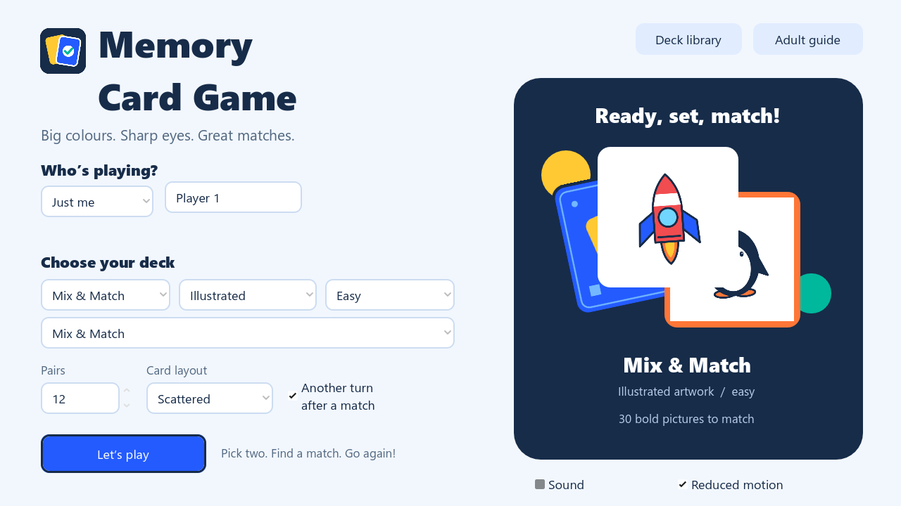

# Memory Card Game

A colourful offline matching game for Windows, built with **Godot 4.7.2 / GDScript / Compatibility**.

[Download for Windows](https://github.com/adpATza/memory-card-game/releases/latest/download/Memory-Card-Game-Windows-x64.zip) · [Editable Godot source](https://github.com/adpATza/memory-card-game/releases/latest/download/Memory-Card-Game-Godot-Source.zip) · [Extra artwork](artwork/README.md)



## Play

Extract the Windows ZIP and open **Memory Card Game.exe**. Keep its PCK beside it. No editor, installer, Python, account or internet connection is needed to play.

Choose 1–4 players, 2–30 pairs, a deck, and scattered or grid layout. The default is one player, 12 **Mix & Match** pairs, scattered, with another turn after a match. Every hidden card has the same blue back.

- Find a matching pair to earn a point and remove the two cards.
- A mismatch stays visible for 1.5 seconds. Cards keep their positions throughout the round.
- Use the mouse, or Tab / Shift+Tab, arrow keys, Space and Enter.
- Escape pauses, conceals revealed pictures and stops the clock.
- Sound and reduced motion can be changed in game. Restarting or leaving asks for confirmation.
- Resizing scales the board uniformly and adds letterboxing.

Requires Windows 64-bit, a 1280 × 720 desktop, and OpenGL 3.3 graphics. The Windows release is tested on Intel UHD Graphics 630. Segoe UI and other available system sans serif fonts are used; no fonts are redistributed.

## Six bright starter decks

Version **2.0.0** introduces a blue, orange, yellow and teal interface, a matching-card icon, and **180 original editable SVG illustrations** on white squares.

| Deck | Subject | Difficulty | Pictures |
| --- | --- | --- | ---: |
| Mix & Match | Animals, vehicles, food, space and toys | Easy | 30 |
| Wild Things | Animals | Easy | 30 |
| On the Move | Vehicles | Easy | 30 |
| Bots & Bolts | Colourful robots | Easy | 30 |
| Bot Buddies | Robots with a shared cyan palette | Medium | 30 |
| Robot Replay | The same blue robot in different poses and expressions | Hard | 30 |

The old starter artwork is preserved in [the source archive folder](artwork/classic-starter-decks/). It is outside the active game. Eight optional collections with **203 additional pictures**, including aircraft, cars, flags, landmarks and cartoon animals, remain available as [separate artwork downloads](artwork/README.md).

## Your own decks and saved data

Open **Deck library → Import an image folder**, choose 2–30 unique PNG / JPEG / WebP pictures, review the thumbnails, and enter the deck name, subject, style and difficulty. Larger folders require selecting a subset. Unreadable files and exact decoded duplicates are rejected.

Pictures are fitted onto white squares with safe margins and copied locally, without stretching or cropping. Originals remain untouched; saved decks work after their source folder moves. Custom decks can be renamed or deleted after confirmation.

Data and preferences live in `%APPDATA%\Memory Card Game\`. On first launch, version 2 copies custom decks and settings from the previous installation's data folder. Existing new data wins; the previous files remain untouched. Removed starter selections fall back to Mix & Match. Back up the data folder with the game closed. Unfinished rounds are not saved.

The game's **Adult guide** and [offline artwork/import guide](docs/Artwork%20and%20Import%20Guide.html) explain artwork preparation, reusable prompts, difficulty and backups.

## Edit, test and build

Open `project.godot` in **Godot 4.7.2 standard**. No add-ons or external runtime dependencies are required. The compact source ZIP includes all current game resources; optional artwork and historical decks are available from this repository and the artwork release.

Regenerate the current SVGs with `python tools/generate_art.py`, and the guides with `python tools/build_guide.py`. The feature plan is in `docs/artwork-plan.csv`.

Install the matching Godot Windows export templates, then run:

```powershell
python tools/package.py --godot "C:\path\Godot_v4.7.2-stable_win64_console.exe"
```

The packager checks scripts, runs the source suite with isolated saved data, exports Windows, tests a copied release executable, verifies persistence in fresh processes, and writes both ZIPs and `SHA256SUMS.txt` into `dist/`. Python 3 is needed only for these development tools.

See [implementation notes](docs/IMPLEMENTATION.md) and [executed verification](verification/VERIFICATION.md). Automated uniqueness and rule checks do not establish human difficulty or compatibility with every PC.

Code and original SVG artwork are MIT licensed. Godot and bundled third-party notices are included in `docs/` and the Windows package. Optional artwork retains its provenance and review records.
